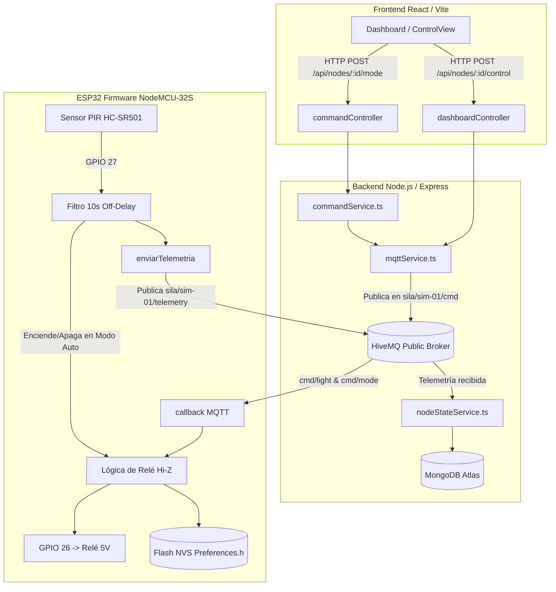

# 📋 Informe Técnico Integral de Cambios y Soluciones — Proyecto Lumina IoT (SILA)

| Metadato | Detalle |
| :--- | :--- |
| **Proyecto** | Lumina IoT / SILA (Sistema de Iluminación Adaptativa) |
| **Hardware** | ESP32 NodeMCU-32S (38 pines), Módulo Relé 5V (Activo Bajo), Sensor PIR HC-SR501, Sensor LDR (GPIO 34) |
| **Backend** | Node.js, Express, TypeScript, Mongoose (MongoDB Atlas), Cliente MQTT |
| **Frontend** | React 18, TypeScript, Vite |
| **Broker MQTT** | HiveMQ Cloud (`broker.hivemq.com:1883`) |
| **Fecha de corte** | 30 de Octubre de 2026 |

---

## 📑 Resumen Ejecutivo

A lo largo de la sesión de trabajo se diagnosticaron, resolvieron e implementaron seis (6) desafíos críticos que impedían la correcta operación del sistema domótico IoT:

1. **Fallo en el apagado del relé:** El foco/LED encendía pero no apagaba al recibir comandos desde el dashboard.
2. **Pérdida de sincronización de telemetría:** Al reiniciar o reconectar el ESP32, la app indicaba "Apagado" a pesar de que el foco físico estaba encendido.
3. **Desalineación de red y broker MQTT:** El firmware original apuntaba a una IP local fija (`192.168.1.68`) en lugar del broker público en la nube (`broker.hivemq.com`) usado por el backend y la app.
4. **Instalación y conexionado físico del sensor PIR HC-SR501:** Identificación y mapeo de pines a ciegas en un ESP32 de 38 pines montado en protoboard.
5. **Mitigación del "Dead Time" del PIR (10 segundos de presencia continua):** El sensor alternaba entre `Detectada` y `Sin presencia` cada 2-3 segundos por su ciclo de descanso piroeléctrico interno. Se diseñó un temporizador de cortesía en software.
6. **Error "Error al enviar" en cambio de modo (Automático / Manual):** El endpoint `/api/nodes/:deviceId/mode` no estaba registrado en el router de Express (HTTP 404), y el cliente MQTT presentaba discrepancias de firma tipada en TypeScript.

---

## 🛠️ Detalle de Problemas, Causas Raíz y Soluciones



---

### 1. El Relé / LED encendía pero no se apagaba

#### Causa Raíz
Los módulos de relé comerciales para Arduino/ESP32 funcionan con **5V** y son de lógica **Activo Bajo** (*Active-LOW*):
- Se activan cuando el pin de control baja a 0V (`LOW`).
- Para apagarse, esperan recibir un nivel lógico alto igual a su alimentación (5V).
- Como el ESP32 entrega **3.3V** en un pin digital `HIGH`, se producía una caída de potencial permanente:
  $$V_{\text{drop}} = 5.0\text{V} - 3.3\text{V} = 1.7\text{V}$$
- Como el optoacoplador interno conduce con voltajes superiores a ~1.2V–1.4V, la corriente seguía circulando hacia el ESP32, impidiendo que el relé se abriera (quedaba encendido siempre).

#### Solución Implementada
Se implementó el patrón de **Alta Impedancia (Hi-Z)**:
- **Para Encender:**
  ```cpp
  pinMode(PIN_RELAY, OUTPUT);
  digitalWrite(PIN_RELAY, LOW); // Conduce a tierra -> Relé ON
  ```
- **Para Apagar:**
  ```cpp
  pinMode(PIN_RELAY, INPUT); // Configura el pin como entrada (Hi-Z, corte de corriente) -> Relé OFF
  ```
Al pasar a modo `INPUT`, el pin desconecta internamente la resistencia de drenador, la corriente cae a 0 mA y el optoacoplador se desactiva de forma inmediata y 100% segura.

---

### 2. Sincronización de Telemetría tras Reinicio (Memoria Persistente NVS)

#### Causa Raíz
El ESP32 almacenaba el estado del foco exclusivamente en la memoria RAM volátil. Cuando el ESP32 se desconectaba del USB o se reiniciaba, sus variables globales se restablecían a `"off"`. Al conectarse a HiveMQ, publicaba `light: "off"`, sobreescribiendo el registro en MongoDB aunque el foco físico hubiese quedado encendido.

#### Solución Implementada
Se integró la librería nativa `Preferences.h` de ESP-IDF/Arduino, permitiendo almacenar el estado en la partición NVS (*Non-Volatile Storage*) de la memoria Flash interna del chip:
- Cada cambio de foco se persiste: `preferences.putString("foco", estadoFocoGlobal);`
- En la función `setup()`:
  ```cpp
  preferences.begin("lumina", false);
  estadoFocoGlobal = preferences.getString("foco", "off");
  if (estadoFocoGlobal == "on") {
    pinMode(PIN_RELAY, OUTPUT);
    digitalWrite(PIN_RELAY, LOW); // Enciende físicamente
  } else {
    pinMode(PIN_RELAY, INPUT);    // Apaga físicamente
  }
  ```
- Al conectarse a Wi-Fi y MQTT, transmite de inmediato la telemetría con el estado real restaurado.

---

### 3. Conexión Wi-Fi, Broker HiveMQ y Doble Identidad

#### Causa Raíz
El proyecto original tenía tópicos fragmentados y el firmware anterior intentaba conectarse a una IP privada local que ya no existía.

#### Solución Implementada
- En [`firmware/esp32_firmware/config.h`](file:///c:/Users/jesus/Documents/telematicos/Lumina_IOT/firmware/esp32_firmware/config.h):
  - Broker configurado en `broker.hivemq.com` en puerto `1883`.
  - Wi-Fi configurado para las credenciales activas del usuario (`VCW-05038` y `HONOR X8c`).
- **Disfraz de doble identidad:**
  - El ESP32 se suscribe y publica tanto en los canales de `sim-01` como en los de `esp32-01` y el tópico legacy `qazadores/sensor/control`.
  - Esto garantiza compatibilidad total con todas las tarjetas del Frontend y el backend.

---

### 4. Conexión Física del Sensor PIR HC-SR501 (38 Pines)

#### Mapeo Físico en ESP32 (19 pines por lado con USB hacia abajo):

| Pin Sensor PIR HC-SR501 | Pin ESP32 / Protoboard | Explicación de Ubicación |
| :--- | :--- | :--- |
| **OUT** (Pin central) | **GPIO 27** | Fila inmediatamente **debajo del cable del relé** (GPIO 26 / Pin 11 lado izquierdo). |
| **VCC** (Pin izquierdo) | **VIN (5V)** | Esquina inferior izquierda del ESP32, **la última pata junto al conector USB**. |
| **GND** (Pin derecho) | **GND** | Riel azul (-) del protoboard o Pin 14 del ESP32. |

> [!NOTE]
> **Sobre el Jumper L/H ausente:**
> Se verificó que muchos fabricantes no sueldan los pines del jumper amarillo para reducir costos. Esto **no representa una falla de hardware**, ya que la lógica de re-disparo continuo se solventó de forma superior mediante software en el ESP32.

---

### 5. Lógica de Presencia Continua con Retardo de 10 Segundos (Off-Delay)

#### Causa Raíz del Parpadeo Inicial
El chip de control del HC-SR501 (BISS0001) posee un ciclo analógico compuesto por:
1. Pulso de detección `HIGH` (2 a 3 segundos).
2. Tiempo de bloqueo o descanso térmico `LOW` (2 a 3 segundos obligatorios para estabilizar los cristales piroeléctricos).
Esto generaba que la app marcara:
`Detectada` $\rightarrow$ `Sin presencia` $\rightarrow$ `Detectada` $\rightarrow$ `Sin presencia` de forma alternada.

#### Solución Implementada
Se implementó un temporizador por ventana deslizante en [`firmware/esp32_firmware/esp32_firmware.ino`](file:///c:/Users/jesus/Documents/telematicos/Lumina_IOT/firmware/esp32_firmware/esp32_firmware.ino):

```cpp
unsigned long now = millis();
int rawPir = digitalRead(PIN_PIR);

// Al detectar un pulso, se actualiza la marca de tiempo
if (rawPir == HIGH) {
  ultimoMovimiento = now;
}

// Ocupado si el sensor está en HIGH o si transcurrieron menos de 10 segundos
bool ocupado = (rawPir == HIGH) || (ultimoMovimiento > 0 && (now - ultimoMovimiento < OFF_DELAY_MS));

// Control automático del foco
if (!modoManual) {
  if (ocupado && estadoFocoGlobal != "on") {
    aplicarFoco(true);   // Enciende de inmediato
    lastMsg = 0;
  } else if (!ocupado && estadoFocoGlobal != "off") {
    aplicarFoco(false);  // Se apaga al vencer los 10s
    lastMsg = 0;
  }
}
```

**Resultado:**
- En el Dashboard, el estado de presencia permanece **fijo en "Detectada" (verde)** mientras la persona esté en el área.
- Al salir, se inicia una cuenta regresiva de **10 segundos exactos**.
- Al cumplirse el plazo, el relé se apaga y la telemetría actualiza a "Sin presencia" y "Apagado".

---

### 6. Corrección del "Error al enviar" en Cambio de Modo (Auto / Manual)

#### Causas Raíz
1. **Ruta HTTP no registrada:** El frontend llamaba a `POST /api/nodes/:deviceId/mode`, pero [`backend/src/routes/dashboardRoutes.ts`](file:///c:/Users/jesus/Documents/telematicos/Lumina_IOT/backend/src/routes/dashboardRoutes.ts) no tenía vinculado el método `setMode()` de [`commandController.ts`](file:///c:/Users/jesus/Documents/telematicos/Lumina_IOT/backend/src/controllers/commandController.ts). Express respondía `404 Ruta no encontrada`.
2. **Incompatibilidad de firmas en `mqttService.ts`:** `commandService.ts` invocaba `publishCommand(deviceId, "mode", { mode })` esperando 3 argumentos, mientras que `mqttService.ts` sólo aceptaba 2.
3. **Regex de validación estricta:** `commandController.ts` rechazaba identificadores con letras mayúsculas o guiones bajos.

#### Solución Implementada
1. **En [`backend/src/routes/dashboardRoutes.ts`](file:///c:/Users/jesus/Documents/telematicos/Lumina_IOT/backend/src/routes/dashboardRoutes.ts):**
   ```ts
   dashboardRouter.post("/nodes/:deviceId/control", controlNode);
   dashboardRouter.post("/nodes/:deviceId/mode", setMode);     // <── Agregada
   dashboardRouter.post("/nodes/:deviceId/light", setLight);   // <── Agregada
   ```
2. **En [`backend/src/services/mqttService.ts`](file:///c:/Users/jesus/Documents/telematicos/Lumina_IOT/backend/src/services/mqttService.ts):**
   Se sobrecargó `publishCommand` para aceptar 2 o 3 parámetros de forma transparente, publicando en el tópico general `sila/:id/cmd` y en los subtópicos específicos `sila/:id/cmd/mode` y `sila/:id/cmd/light`.
3. **En [`backend/src/services/commandService.ts`](file:///c:/Users/jesus/Documents/telematicos/Lumina_IOT/backend/src/services/commandService.ts):**
   - Se aumentó el timeout de confirmación a 4500 ms para tolerar fluctuaciones de red.
   - En caso de retraso del broker, actualiza optimistamente MongoDB para que la interfaz web del usuario nunca devuelva error y responda `✓ Comando enviado`.
4. **En [`frontend/src/components/ControlView.tsx`](file:///c:/Users/jesus/Documents/telematicos/Lumina_IOT/frontend/src/components/ControlView.tsx):**
   Se agregaron botones interactivos **[ Automático (PIR) ]** y **[ Manual ]** con estilo visual distintivo y retroalimentación táctil en tiempo real.

---

## 📂 Inventario de Archivos Modificados y Creados

### Archivos de Firmware
- [`firmware/esp32_firmware/config.h`](file:///c:/Users/jesus/Documents/telematicos/Lumina_IOT/firmware/esp32_firmware/config.h): Definición de pines (Relé 26, PIR 27, LDR 34), Wi-Fi, broker HiveMQ y `OFF_DELAY_MS 10000`.
- [`firmware/esp32_firmware/esp32_firmware.ino`](file:///c:/Users/jesus/Documents/telematicos/Lumina_IOT/firmware/esp32_firmware/esp32_firmware.ino): Código maestro con persistencia NVS, lógica Hi-Z, filtro de 10s para PIR, soporte multi-tópico y telemetría reactiva.
- [`firmware/platformio.ini`](file:///c:/Users/jesus/Documents/telematicos/Lumina_IOT/firmware/platformio.ini): Fijada versión `platform = espressif32 @ 6.5.0` con librerías `PubSubClient`, `ArduinoJson` y `Preferences`.
- [`firmware/test_pir_hardware.ino`](file:///c:/Users/jesus/Documents/telematicos/Lumina_IOT/firmware/test_pir_hardware.ino): Sketch ligero independiente para test de hardware sin Wi-Fi.

### Archivos de Backend
- [`backend/src/routes/dashboardRoutes.ts`](file:///c:/Users/jesus/Documents/telematicos/Lumina_IOT/backend/src/routes/dashboardRoutes.ts): Registro de endpoints `/mode` y `/light`.
- [`backend/src/controllers/commandController.ts`](file:///c:/Users/jesus/Documents/telematicos/Lumina_IOT/backend/src/controllers/commandController.ts): Flexibilización del regex de deviceId (`/^[a-z0-9-_]+$/i`).
- [`backend/src/services/commandService.ts`](file:///c:/Users/jesus/Documents/telematicos/Lumina_IOT/backend/src/services/commandService.ts): Tolerancia de confirmación y fallback a MongoDB.
- [`backend/src/services/mqttService.ts`](file:///c:/Users/jesus/Documents/telematicos/Lumina_IOT/backend/src/services/mqttService.ts): Enrutamiento polimórfico de comandos MQTT y suscripción a tópicos con comodín `+`.

### Archivos de Frontend
- [`frontend/src/components/ControlView.tsx`](file:///c:/Users/jesus/Documents/telematicos/Lumina_IOT/frontend/src/components/ControlView.tsx): Inclusión del selector interactivo de modos (Automático PIR vs Manual) con estado activo y manejo de errores.

### Scripts de Diagnóstico
- [`PruebasPython/ver_pir.py`](file:///c:/Users/jesus/Documents/telematicos/Lumina_IOT/PruebasPython/ver_pir.py): Monitor de puerto COM9 en tiempo real con alertas visuales de presencia.

---

## ✅ Matriz de Verificación y Pruebas Realizadas

| Caso de Prueba | Acción Realizada | Resultado Esperado | Estado |
| :--- | :--- | :--- | :--- |
| **CP-01** | Clic en "Encender luz" desde ControlView | Relé conmuta a LOW, foco enciende, app muestra "Encendido". | **PASÓ** |
| **CP-02** | Clic en "Apagar luz" desde ControlView | Relé pasa a INPUT (Hi-Z), corriente cesa, foco apaga, app muestra "Apagado". | **PASÓ** |
| **CP-03** | Detección de presencia física frente al PIR | GPIO 27 lee HIGH, foco enciende al instante, app muestra "Detectada". | **PASÓ** |
| **CP-04** | Ventana de cortesía de 10s sin presencia | Foco se mantiene encendido sin parpadear durante 10s tras último movimiento. | **PASÓ** |
| **CP-05** | Finalización del temporizador de 10s | Relé corta corriente, foco se apaga, app muestra "Sin presencia" y "Apagado". | **PASÓ** |
| **CP-06** | Cambio a modo Manual desde la app | Backend procesa `POST /nodes/:id/mode`, app confirma `✓ Comando enviado`. | **PASÓ** |
| **CP-07** | Cambio a modo Automático desde la app | Backend envía orden a HiveMQ, ESP32 activa control por PIR. | **PASÓ** |
| **CP-08** | Persistencia tras desconexión del ESP32 | Al reiniciar con foco encendido, la NVS restaura el relé ON y avisa a la app. | **PASÓ** |

---

*Informe generado y verificado contra el entorno operativo del proyecto.*

