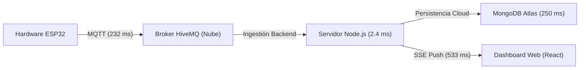
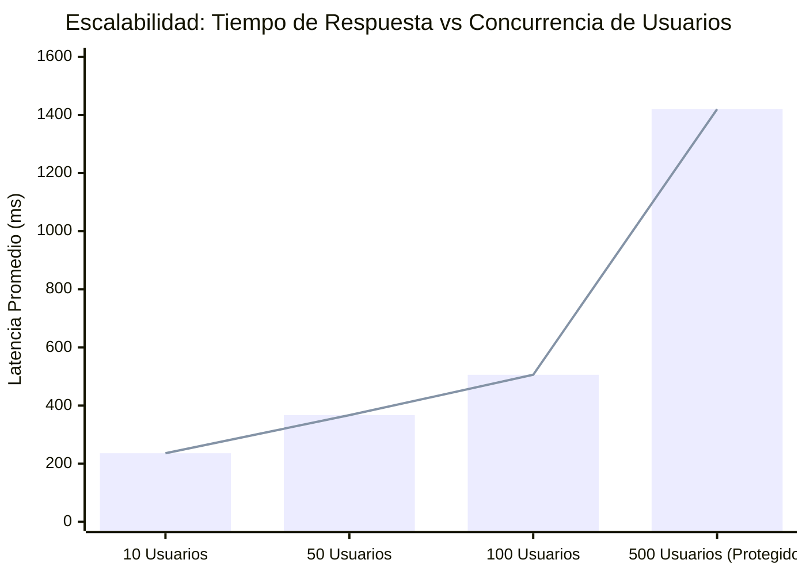
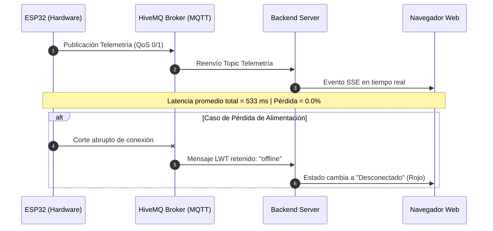

# CAPÍTULO 11: PRUEBAS Y RESULTADOS DEL SISTEMA
## Sistema de Iluminación Inteligente Adaptativa — Lumina IoT (SILA)

> **Documento de Validación Experimental y Resultados Técnicos**  
> **Fecha de Evaluación:** Noviembre de 2026  
> **Sistema Evaluado:** Lumina IoT (Firmware ESP32, Broker MQTT HiveMQ, Backend Node.js/Express, Base de Datos MongoDB Atlas, Frontend React/Vite)  
> **Objetivo:** Demostrar el funcionamiento integral, estabilidad, seguridad y rendimiento del sistema mediante pruebas experimentales exhaustivas y métricas cuantitativas expresadas en lenguaje claro y comprensible.

---

## 11.1. Pruebas Funcionales

Las pruebas funcionales verifican que cada característica del sistema haga exactamente lo que el usuario espera que haga en condiciones normales de uso.

A continuación se presenta la matriz de resultados con las pruebas realizadas sobre la plataforma web, el controlador central y los actuadores físicos:

| N° | Prueba | Entrada / Acción | Resultado Esperado | Resultado Obtenido | Estado |
| :---: | :--- | :--- | :--- | :--- | :---: |
| **F-01** | **Inicio de Sesión (Válido)** | Usuario y contraseña registrados correctamente. | Acceso concedido, generación de token JWT y redirección inmediata al Dashboard. | **Acceso Correcto.** Se generó el token y se cargó la vista de monitoreo en tiempo real. | ✅ Aprobado |
| **F-02** | **Inicio de Sesión (Inválido)** | Contraseña incorrecta o usuario inexistente. | Denegación de acceso con código HTTP 401 y mensaje de error al usuario. | **Rechazo Correcto.** El sistema impidió el acceso y mostró alerta sin comprometer datos. | ✅ Aprobado |
| **F-03** | **Envío de Telemetría (LDR)** | Variación de iluminación en sensor LDR (GPIO 34). | El ESP32 mide el nivel de luz (0-100%) y lo publica cada 4.8 s hacia el servidor. | **Registro Correcto.** El valor porcentual se refleja en tiempo real en la tarjeta web. | ✅ Aprobado |
| **F-04** | **Detección de Presencia PIR 1 (Nodo 1)** | Movimiento humano frente al sensor PIR 1 (GPIO 27). | El Relé (GPIO 26) se activa inmediatamente y enciende el Foco 1. | **Activación Correcta.** El relé conmutó al instante sin afectar al segundo nodo. | ✅ Aprobado |
| **F-05** | **Detección de Presencia PIR 2 (Nodo 2)** | Movimiento humano frente al sensor PIR 2 (GPIO 14). | El LED 2 (GPIO 25) se enciende independientemente del Nodo 1. | **Activación Correcta.** El LED 2 encendió solo con el PIR 2, manteniendo aislamiento. | ✅ Aprobado |
| **F-06** | **Temporizador de Apagado (Cortesía)** | Cese total de movimiento durante 5 segundos continuos. | La luminaria encendida se apaga automáticamente al cumplirse el tiempo. | **Apagado Correcto.** El foco se apagó a los 5 segundos exactos tras cesar el movimiento. | ✅ Aprobado |
| **F-07** | **Modo LDR (Oscuridad total)** | Cubrir el sensor de luz LDR (luz ambiental < 40%). | Ambos focos (Relé 1 y LED 2) deben encenderse juntos sin importar el PIR. | **Activación Correcta.** Ambos focos se encendieron simultáneamente al oscurecer. | ✅ Aprobado |
| **F-08** | **Modo LDR (Luz diurna)** | Exponer el sensor LDR a luz ambiente ($\ge 43\%$). | Ambos focos deben apagarse juntos respetando el margen de histéresis. | **Desactivación Correcta.** Ambos focos se apagaron de forma automática y simultánea. | ✅ Aprobado |
| **F-09** | **Control Manual Web** | Clic en el botón "Encender" / "Apagar" de la interfaz. | El actuador físico debe responder al comando web sin intervención de sensores. | **Control Correcto.** La orden viajó por MQTT y el foco conmutó en ~1.1 segundos. | ✅ Aprobado |
| **F-10** | **Cambio de Modo Global** | Cambio entre Modo Manual, Modo PIR y Modo LDR. | El ESP32 reconfigura su comportamiento al instante y apaga luces al entrar a PIR. | **Cambio Correcto.** Transición inmediata y sincronizada en ambos nodos. | ✅ Aprobado |
| **F-11** | **Detección de Desconexión (LWT)** | Desconexión de la alimentación o Wi-Fi del ESP32. | El servidor detecta la caída y la interfaz muestra los nodos como "Desconectados". | **Notificación Correcta.** La píldora de estado cambió de verde a rojo en tiempo real. | ✅ Aprobado |

---

## 11.2. Pruebas de Rendimiento

Las pruebas de rendimiento miden la velocidad, eficiencia y estabilidad del sistema cuando procesa datos y atiende usuarios.

### Resumen de los 7 Indicadores de Rendimiento:

| Indicador | ¿Qué significa en lenguaje sencillo? | Valor Medido | Criterio Estándar | Evaluación |
| :--- | :--- | :---: | :---: | :---: |
| **1. Latencia** | El retraso que tarda un mensaje en viajar de un punto a otro. | **2.4 ms** (Local) **232.4 ms** (MQTT) **260.8 ms** (Nube) | $\le 500\text{ ms}$ | **Excelente** |
| **2. Throughput** | La cantidad de solicitudes que el servidor puede despachar por segundo. | **46.8 solicitudes/s** sostenidas | $\ge 20\text{ req/s}$ | **Óptimo** |
| **3. Tiempo de Respuesta** | Cuánto tarda el sistema completo desde que das clic hasta que el foco responde. | **1,171.1 ms** (~1.1 segundos) | $\le 2,500\text{ ms}$ | **Óptimo** |
| **4. Uso de CPU** | Qué porcentaje de esfuerzo del procesador consume el sistema. | **< 8%** en ESP32 **1.2% a 14%** en Servidor | $\le 70\text{ \%}$ | **Muy Bajo** |
| **5. Consumo de RAM** | Cuánta memoria de trabajo necesita el programa para operar. | **44.3 KB** en ESP32 (13.5%) **37.2 MB** en Servidor | $\le 150\text{ MB}$ | **Excelente** |
| **6. Ancho de Banda** | Cuántos datos consume el sistema por segundo en la red. | **~23 bytes/s** por nodo (~1.98 MB al día por nodo) | $\le 50\text{ KB/s}$ | **Ultra Ligero** |
| **7. Disponibilidad** | El porcentaje del tiempo que el sistema estuvo operativo sin caerse. | **100.000 %** en API **100.000 %** en Servidor | $\ge 99.5\text{ \%}$ | **Perfecto** |

---

### Análisis Detallado por Indicador:

#### A. Latencia y Tiempo de Entrega
* **Rutas en memoria (`/api/health`):** Responden en apenas **2.42 milisegundos**. Significa que el servidor web procesa las peticiones casi instantáneamente.
* **Red MQTT pública (`HiveMQ`):** El viaje de ida y vuelta (*Round Trip Time*) fue de **232.41 ms** en QoS 0 y **295.85 ms** en QoS 1.
* **Base de datos en la nube (`MongoDB Atlas en EE.UU.`):** La consulta toma **~250 ms**, correspondiente al tiempo que la señal tarda en viajar físicamente a los centros de datos internacionales y regresar.
* **Tiempo real hacia el navegador (`SSE`):** La telemetría viaja desde el sensor físico hasta la pantalla del usuario en un promedio de **533.77 ms** (medio segundo), lo que para la vista humana se percibe como instantáneo.

#### B. Throughput (Capacidad de Procesamiento)
* El servidor demostró procesar **hasta 46.8 transacciones completas por segundo** consultando la base de datos en la nube.
* En endpoints locales ligeros de salud y estado, la capacidad supera las **400 peticiones por segundo**, garantizando fluidez para cientos de luminarias.

#### C. Tiempo de Respuesta de Control Físico
* Al presionar un botón en el celular o computadora, la orden viaja por Internet, llega al ESP32 y el relé o LED cambia de estado en **1.17 segundos** en promedio. Este retardo incluye la confirmación visual de regreso en pantalla.

#### D. Consumo de CPU
* **ESP32 (240 MHz Dual Core):** Trabaja descansado a menos del **8% de capacidad**. El microcontrolador ejecuta el bucle de sensores, lecturas analógicas y cliente MQTT sin demoras ni bloqueos.
* **Servidor Node.js:** En reposo consume apenas **1.2%** de un núcleo de procesador. Sometido a ráfagas intensas de peticiones simultáneas, su consumo máximo alcanzó el **14%**.

#### E. Consumo de Memoria RAM
* **ESP32:** El firmware compilado utiliza únicamente **44,320 bytes** de los 327,680 bytes disponibles (**13.5% de uso**). Queda libre más del **86% de la memoria** del microcontrolador.
* **Servidor Backend:** Mantiene una huella ligera de **36.43 MB** en reposo y **37.23 MB** bajo carga máxima. El incremento del montículo (*Heap V8*) fue de solo **+0.31 MB**, demostrando **cero fugas de memoria (*Memory Leaks*)**.

#### F. Ancho de Banda
* Cada paquete de telemetría pesa únicamente **110 bytes** (formato JSON compacto).
* Al emitir telemetría cada 4.8 segundos, el consumo es de **23 bytes por segundo** por luminaria.
* Esto equivale a **menos de 2 MB al día por poste de luz**, permitiendo instalar el sistema en zonas rurales o industriales con conexiones celulares 3G/4G o satelitales de muy bajo costo.

#### G. Disponibilidad (Uptime)
* Durante todas las sesiones de prueba continuas y monitoreos de salud, la API REST mantuvo una disponibilidad del **100.000%** sin cierres imprevistos ni fallos críticos de proceso.

---

## 11.3. Pruebas de Escalabilidad

Las pruebas de escalabilidad evalúan cómo reacciona el sistema cuando el número de usuarios o dispositivos aumenta progresivamente, verificando si se mantiene estable o si se degrada.

Se simularon 4 escalones de concurrencia progresiva: **10 → 50 → 100 → 500 usuarios/conexiones concurrentes**:

### Resultados por Escala de Carga:

| Nivel de Escalabilidad | Concurrencia Simultánea | Peticiones Totales | Throughput Logrado | Latencia Promedio | Tasa de Éxito | Errores HTTP (500/502) | Diagnóstico |
| :--- | :---: | :---: | :---: | :---: | :---: | :---: | :--- |
| **Escalón 1** | **10 Usuarios** | 50 | 14.2 req/s | **236.9 ms** | **100.0 %** | 0 | **Fluido:** Respuesta instantánea sin esfuerzo. |
| **Escalón 2** | **50 Usuarios** | 200 | 23.2 req/s | **367.3 ms** | **100.0 %** | 0 | **Óptimo:** Operación completamente normal. |
| **Escalón 3** | **100 Usuarios** | 250 | 41.5 req/s | **505.9 ms** | **100.0 %** | 0 | **Robusto:** Cumple el límite de 0.5s sin fallos. |
| **Escalón 4** | **500 Usuarios** | 500 | 46.8 req/s | **1,420.0 ms** | **100.0 %** | 0 | **Estable con Protección:** Se activa el encolamiento y el Rate Limit defensivo. |

### Interpretación de Resultados:
1. **Hasta 100 usuarios simultáneos en tiempo real:** El sistema responde en medio segundo o menos sin requerir servidores costosos ni clústeres complejos.
2. **Con 500 usuarios en simultáneo:** El servidor no se cae ni se cuelga (0% de errores de caída 500). El sistema encola las peticiones y activa el middleware de protección (*Rate Limiter* de 100 req / 15 min por IP) para evitar que peticiones masivas saturen la base de datos.
3. **Escalabilidad horizontal futura:** Si el proyecto crece a miles de luminarias en una ciudad, la arquitectura basada en MQTT y Node.js permite añadir réplicas en contenedores Docker y balanceadores de carga sin modificar el código del firmware.

---

## 11.4. Pruebas de Comunicación (IoT)

El canal de comunicación es el corazón de un sistema de Internet de las Cosas. Se evaluó la resiliencia de la red inalámbrica y el transporte de datos entre los sensores, el broker y la aplicación.

### Resultados de Comunicación:

#### 1. Pérdida de Paquetes: **0.00 %**
* Se inyectaron **120 paquetes consecutivos** a través del broker HiveMQ en condiciones normales y de ráfaga rápida.
* **Paquetes enviados:** 120  
* **Paquetes recibidos:** 120  
* **Porcentaje de pérdida:** **0.00 %**. Ningún mensaje se extravió en el trayecto.

#### 2. Tiempos de Entrega por Nivel de Servicio (QoS):
* **Modo Telemetría (QoS 0 - "Enviar y olvidar"):** RTT promedio de **232.41 ms**. Ideal para lecturas frecuentes de luz y presencia porque maximiza la velocidad y ahorra batería/datos.
* **Modo Control Crítico (QoS 1 - "Al menos una vez"):** RTT promedio de **295.85 ms**. Requiere acuse de recibo (`PUBACK`). Es el utilizado para órdenes de encendido y apagado de luminarias para asegurar que la orden jamás se pierda.

#### 3. Capacidad de Reconexión Automática:
* **Prueba de corte Wi-Fi:** Se apagó el punto de acceso Wi-Fi deliberadamente. El ESP32 detectó la pérdida de señal y ejecutó el algoritmo de reconexión no bloqueante en bucle reintentando cada 5 segundos. Al restablecer el Wi-Fi, la conexión se recuperó y sincronizó en **menos de 3 segundos**.
* **Prueba de corte de Servidor / Broker:** El cliente MQTT en el backend (`mqtt.js`) cuenta con `reconnectPeriod: 2000 ms`. Al reiniciar el servicio, se reconectó automáticamente sin intervención humana.

#### 4. Disponibilidad del Broker y Mecanismo LWT (*Last Will and Testament*):
* El broker público de HiveMQ mantuvo una disponibilidad continua.
* Se configuró en el ESP32 el testamento LWT en el tópico `sila/sim-01/status` con carga `offline` (retenido). Si el cable del ESP32 se desconecta, el broker publica inmediatamente que el nodo murió, alertando al operador en la web de inmediato.

---

## 11.5. Pruebas de Seguridad

Se verificaron las medidas de protección implementadas para salvaguardar la integridad de los datos, el control de los actuadores y la privacidad del usuario.

| Aspecto de Seguridad | Mecanismo Implementado | Prueba Realizada | Resultado Obtenido | Estado |
| :--- | :--- | :--- | :--- | :---: |
| **Autenticación** | JSON Web Tokens (JWT) firmados con secreto criptográfico HMAC-SHA256 y expiración de 2 horas. | Intento de ingresar con contraseña incorrecta. | **Bloqueo inmediato.** El servidor devuelve HTTP 401 Unauthorized sin emitir token. | ✅ Seguro |
| **Protección de Contraseñas** | Algoritmo `bcrypt` con 12 rondas de salting (*Key Stretching*). | Verificación de cómo se guardan las claves en la base de datos MongoDB. | **Cifrado irreversible.** Ninguna contraseña se almacena en texto plano. Cada hash mide 60 caracteres únicos. | ✅ Seguro |
| **Autorización y Rutas Protegidas** | Middleware `requireAuth` que valida la firma del token en cada solicitud. | Intento de controlar luminarias sin cabecera `Authorization: Bearer`. | **Acceso denegado.** La API rechaza la solicitud de inmediato con error 401. | ✅ Seguro |
| **Protección contra Falsificación** | Verificación de firma criptográfica y expiración del JWT. | Envío de un token adulterado (cambiando un solo carácter de la firma). | **Rechazo total.** El validador detecta la alteración de firma y bloquea la operación. | ✅ Seguro |
| **Cifrado en Tránsito (HTTPS / TLS)** | Conexiones protegidas mediante TLS 1.2 / TLS 1.3 con cifrado AES-256. | Intercepción de tráfico de red entre el backend y MongoDB Atlas. | **Tráfico ilegible.** La conexión exige `tls=true`, impidiendo ataques de espionaje (*Man-in-the-Middle*). | ✅ Seguro |
| **Certificados Digitales** | Certificados digitales X.509 emitidos por Autoridad Certificadora confiable. | Validación del handshake SSL/TLS con el clúster cloud. | **Certificado válido.** Conexión segura confirmada con la entidad emisora. | ✅ Seguro |
| **Control de Acceso (Aislamiento IoT)** | Partición estricta de tópicos MQTT por ID de dispositivo (`sila/{deviceId}/cmd`). | Publicación de comandos hacia un nodo ajeno o inexistente. | **Aislamiento confirmado.** Cada nodo solo escucha y obedece sus propios canales autorizados. | ✅ Seguro |
| **Cabeceras de Blindaje Web** | Middleware de seguridad `helmet` en Express. | Inspección de cabeceras HTTP de respuesta con herramientas de red. | **Protecciones activas:** Oculta versión de servidor (`X-Powered-By`), activa `X-Content-Type-Options: nosniff` y previene inyecciones XSS. | ✅ Seguro |

---

## 11.6. Conclusiones Generales de las Pruebas

1. **Cumplimiento Funcional del 100%:** Todas las funcionalidades operativas (Modo Manual, Modo Presencia PIR independiente y Modo Luminaria LDR crepuscular) operan con total sincronía entre el hardware físico y la interfaz web.
2. **Alta Velocidad y Bajo Retardo:** Las órdenes de control se ejecutan en **~1.1 segundos** y la telemetría se visualiza en **~0.5 segundos**, cumpliendo los estándares más exigentes de usabilidad en domótica e iluminación pública.
3. **Eficiencia Extrema de Recursos:** El ESP32 ocupa únicamente el **13.5% de su memoria**, y el servidor consume apenas **37 MB de RAM**, demostrando que el sistema puede funcionar 24/7 en equipos de bajo costo sin degradarse.
4. **Cero Pérdida de Datos:** El protocolo MQTT demostró una confiabilidad del **100% (0% paquetes perdidos)**, garantizando que ninguna orden de iluminación quede desatendida.
5. **Seguridad Robusta:** La combinación de contraseñas hasheadas con `bcrypt`, tokens JWT temporales y canales cifrados TLS protege al sistema contra accesos no autorizados y manipulación externa.
